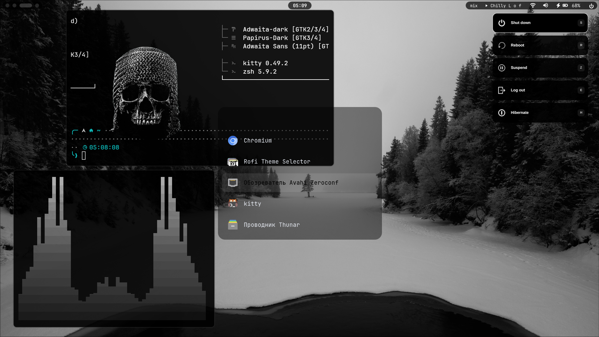
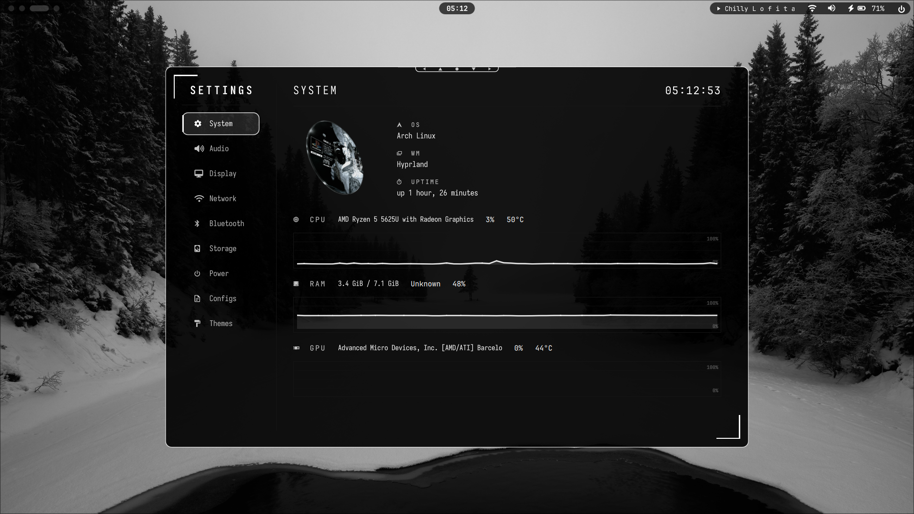
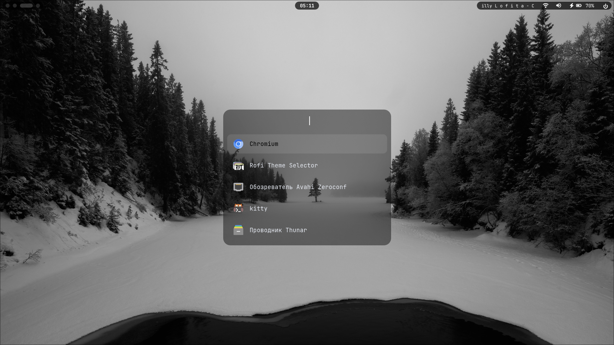
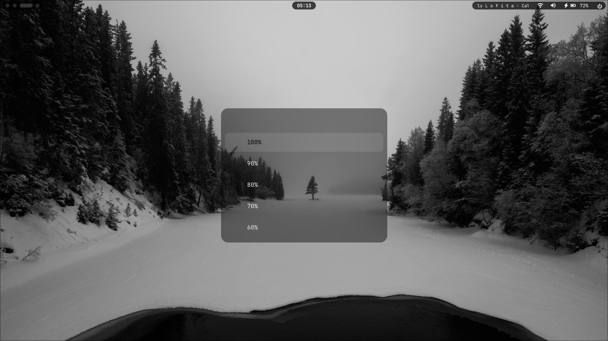

<div align="center">

# Arch Linux · Hyprland Dotfiles

**A minimal Linux desktop with a monochrome graphite aesthetic.**

Hyprland · Quickshell · Waybar · Rofi · Kitty


</div>

---

## Desktop Preview

<p align="center">
  
</p>

<p align="center">
  
  
  
</p>

## Features

- Minimal monochrome graphite theme
- Quickshell panels, widgets and system controls
- Waybar status bar and media controls
- Rofi application launcher and menus
- Personal theme controller with theme presets
- Wallpaper selection and rotation using `awww`
- Hyprlock and Hypridle configuration
- Kitty terminal configuration

## Keybindings

| Shortcut | Action |
| --- | --- |
| `Super + W` | Open wallpaper picker |
| `Super + O` | Open opacity controls |
| `Super + L` | Toggle light and dark themes |

## Installation

### Requirements

- Arch Linux
- Internet connection
- `sudo` privileges
- A backup of your existing configuration

### 1. Clone the repository

```bash
git clone https://github.com/Alex29085/arch-hyprland-dotfiles.git
cd arch-hyprland-dotfiles
```

### 2. Review the installer

Read `install.sh` before running it.

The installer uses `pacman -Syu`, which updates the system as well as installing required packages. It backs up the selected configuration paths and asks for confirmation before replacing them.

### 3. Run the installer

```bash
./install.sh
```

> [!WARNING]
> Selected directories under `~/.config` are replaced, not merged. Back up your existing configuration and review the installer before proceeding.

The installer does **not** copy wallpapers, generate a theme, or restart Hyprland.

## Wallpapers

Place wallpaper images in:

```text
~/Pictures/Wallpapers
```

## Configuration

```text
.config/
├── hypr/            # Hyprland settings and keybindings
├── waybar/          # Status bar
├── quickshell/      # Panels and widgets
├── rofi/            # Launcher and menus
└── personal-theme/  # Theme controller and presets
```

Review the configuration files before making changes.

## License

Original contributions by **ALEKS** are licensed under the MIT License in [`LICENSE`](LICENSE).

Components derived from 43PR's project remain subject to the original MIT License and copyright notice preserved in [`LICENSE-43PR`](LICENSE-43PR).

---

<div align="center">

Made for a clean, focused Linux desktop.

</div>
